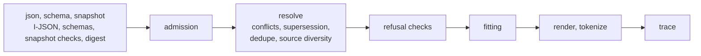

# Contributing to assembler-rust

This is a Rust assembler for the [Context Window Architecture](https://contextwindowarchitecture.io) draft. The specification lives in its own repository, [contextwindowarchitecture/contextwindowarchitecture](https://github.com/contextwindowarchitecture/contextwindowarchitecture). If a change alters what an assembler must do, it starts there, and this repository follows.

[AGENTS.md](AGENTS.md) holds the full rules. Coding agents and people follow the same ones. [PORTING.md](PORTING.md) is the guide this port was built from. This page is the short version.

## Set up

You need Rust 1.80 or newer. That release stabilized `std::sync::LazyLock`, and CI builds and tests on 1.80 and on stable. The dependencies (`serde`, `serde_json`, `regex` and `sha2`) need at most 1.71.

```sh
cargo build
cargo test       # the full suite; it must pass before every commit
```

## How changes are made

**Test first.** Every behavior change starts with a test that fails for the right reason. Next comes the least code that makes it pass, then cleanup with the suite green. A bug fix starts with a test that reproduces the bug.

**Work from the published spec only.** Use the contract vendored in `vendor/cwa/`, and don't read or borrow from the other implementations. Two independent ports that disagree while both pass every case expose a gap in the spec. Where the spec leaves a behavior open, the fix goes into the specification repository first.

**`assemble` stays pure.** It reads no file, network, environment or model. Only `trace_id` and `timings` may differ between two runs of the same snapshot.

**Documentation moves with the code.** A commit that changes behavior also updates the rustdoc of the API it changes and the README section a caller would read. The README is written for application developers. Keep its Status section to a few sentences.

## How the code is laid out

The modules follow the pipeline:



- `json` and `schema` read and validate a snapshot, and `snapshot` runs the snapshot checks and computes the digest.
- `admission`, `resolve` (conflicts, supersession, deduplication, source diversity) and `fitting` assemble it.
- `render` and `tokenize` provide the published components, and `trace` holds the output.
- `strings`, `instant` and `canonical` implement the conformance README's Ordering, Timestamps and RFC 8785 rules.
- `contract` reads the vendored reason codes, slot defaults and published component ids.

## Commits

- One behavior, or one refactor, per commit, and every commit passes the full suite. When you pipe test output, run `set -o pipefail` first, or a failing run looks green.
- Use [Conventional Commits](https://www.conventionalcommits.org/en/v1.0.0/): `type(scope): summary`, lower case, imperative, at most 72 characters. The body says why and lists the requirement IDs affected. AGENTS.md lists the types and scopes.
- Sign off every commit (`git commit -s`).
- `CHANGELOG.md` is generated from commit subjects by [git-cliff](https://git-cliff.org), so never edit it by hand. Regenerate it at a release with `uvx git-cliff --tag vX.Y.Z -o CHANGELOG.md`.

## Conformance

Every case under `vendor/cwa/conformance/cases/` is a test. It feeds in a snapshot, then compares the payload byte for byte and the trace field for field, except `trace_id`, `timings` and `recovery.detail`. Every rejection snapshot under `rejections/` must be rejected before assembly.

```sh
cargo run --release --example conformance   # run every case natively and write conformance-report.json
python3 scripts/check_report.py             # check the committed report is complete and well-formed
```

The runner exits 1 unless every case passed and every rejection snapshot was rejected, apart from those skipped for an optional component. A case is skipped only when it uses a tokenizer or renderer the conformance README lists under Optional and this package does not provide it. The committed report must be the current run, and a test fails when it goes stale. Its `contract` names the repository and commit the vendored cases came from.

To cross-check the native runner, run the same cases through the template's runner and the adapter protocol:

```sh
cargo build --release --example adapter
python3 scripts/conformance.py --command target/release/examples/adapter --name contextwindowarchitecture-assembler --version 0.0.1 --language Rust --out /tmp/report.json
```

Both runners are examples, not binaries, so `cargo install` never puts them on a PATH. They read the cases from this checkout.

## The contract is vendored

`vendor/cwa/` holds the published contract: the schemas, the contract data and the conformance cases, copied from the specification repository. `vendor/cwa.lock.json` pins each file by SHA-256 and records the repository and the commit the files came from. Don't edit them here, because a test fails if you do. Change the specification repository, commit there, then re-vendor:

```sh
python3 scripts/vendor_contract.py --spec ../contextwindowarchitecture           # copy and rewrite the lock
python3 scripts/vendor_contract.py --verify                                      # check vendor/cwa/ against its lock
python3 scripts/vendor_contract.py --spec ../contextwindowarchitecture --check   # check for drift from a checkout
```

Re-vendor only from a committed state of the specification repository. The vendored contract is Apache-2.0 licensed; see `vendor/cwa/LICENSE` and `vendor/cwa/NOTICE`.

## CI and releases

CI ([.github/workflows/ci.yml](.github/workflows/ci.yml)) builds and tests on Rust 1.80 and stable. It checks the committed conformance report against the contract, and the vendored contract against the specification commit the lock pins.

Each tag gets a GitHub release once CI passes on the tagged commit ([.github/workflows/release.yml](.github/workflows/release.yml)). The release notes name the specification commit, then list the tag's own commits, written by git-cliff. A tag that isn't `vX.Y.Z`, such as `draft-release`, is a prerelease. A tag pushed before the workflow existed is released with `gh workflow run release.yml -f tag=<tag>`.
