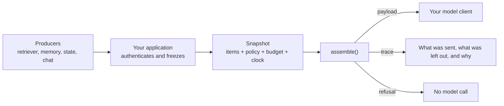

# assembler-rust

[](https://github.com/contextwindowarchitecture/assembler-rust/actions/workflows/ci.yml)
[](https://crates.io/crates/contextwindowarchitecture-assembler)
[](Cargo.toml)
[](https://contextwindowarchitecture.io/spec.html)
[](LICENSE)

Decide what your model sees, and keep a record of why.

assembler-rust is a Rust assembler for the [Context Window Architecture](https://contextwindowarchitecture.io) (CWA) specification. You give it everything that *could* go into a model request. It gives back the exact request to send and a trace of every decision. When the request would break your policy, it gives back a refusal instead, before any model is called.

## What is assembler-rust

Most applications build a prompt by gluing strings together: a system prompt, some retrieved chunks, the chat history and the question. That works until something goes wrong. Then nobody can say which chunks were sent, which were dropped to fit the context window, or why a retrieved web page ended up next to the system prompt.

CWA treats the request as compiled output instead:

1. **Producers** (your retriever, memory store, account service, chat history) propose typed **items** for named **slots**.
2. **Your application** freezes those items, a versioned **route policy** and a **budget** into an immutable **snapshot**.
3. **The assembler** turns the snapshot into a **payload**, the exact bytes to send, and a **trace** that says what went in, what was left out and why. When the snapshot can't produce a request that meets the policy, the assembler returns a **refusal** with the trace instead.



`assemble` is a pure function of the snapshot's bytes. The same snapshot always yields the same payload, so you can store a snapshot and replay it later to debug an answer, review a policy change, or audit what a model was shown. Only the trace's `trace_id` and `timings` vary between runs.

assembler-rust **is not** a retriever, an LLM client, an agent framework or a prompt template library. It sits between the code that gathers context and the code that calls the model, and works with whatever you already use on either side.

## Status

assembler-rust is a draft that tracks the CWA draft specification (`cwa/draft`), so the API and snapshot format can change before v1. The committed [conformance report](conformance-report.json) records the result for each published case and rejection snapshot of the vendored contract.

## Install

From crates.io:

```sh
cargo add contextwindowarchitecture-assembler
```

Or from the `draft-release` tag, to follow the current draft:

```toml
[dependencies]
contextwindowarchitecture-assembler = { git = "https://github.com/contextwindowarchitecture/assembler-rust", tag = "draft-release" }
```

The library is `contextwindowarchitecture_assembler`. It needs Rust 1.80 or newer, and its only dependencies are `serde`, `serde_json`, `regex` and `sha2`.

## Quickstart

A support bot gets a question. The retriever found two chunks, and only one of them is relevant.

```rust
use contextwindowarchitecture_assembler::{assemble, Error};
use serde_json::json;

let snapshot = serde_json::to_vec(&json!({
    "assembly_time": "2026-10-21T12:00:00Z",          // the clock, frozen like everything else
    "scope": {"tenant": "acme", "user": "u_42", "session": "s_1", "task": "support"},
    "budget": {"input": 8000, "reserved_output": 1024, "margin_percent": 10},
    "profile": profile,             // where each slot lands in the request
    "route_policy": route_policy,   // which producer may write which slot, and each slot's rules
    "tokenizer": "estimate-utf8/v1",
    "renderer": "cwa-messages/v1",
    "batches": batches,             // what each producer proposed: instructions, two chunks, the question
    "conflicts": []
}))?;

match assemble(&snapshot) {
    Ok(assembly) => {
        match &assembly.payload {
            // {"system": [...], "tools": [...], "messages": [...]}
            Some(bytes) => { let request: serde_json::Value = serde_json::from_slice(bytes)?; }
            None => println!("refused: {:?}", assembly.trace.refused.reason),
        }
        for row in &assembly.trace.excluded {
            println!("{} {}", row["item_id"], row["reason"]);   // "kb:pricing" "below_threshold"
        }
    }
    Err(Error::Rejected(problems)) => { /* an invalid snapshot: no payload and no trace */ }
    Err(other) => { /* a component this package doesn't provide, or a tokenizer under a published id */ }
}
```

[examples/quickstart.rs](examples/quickstart.rs) is the complete, runnable version, with the policy, the profile and the items written out:

```sh
cargo run --example quickstart
```

```text
{
  "messages": [
    {
      "content": "<evidence id=\"kb:refunds\">\nPro plans can be refunded in full within 30 days of purchase.\n</evidence>\n<query id=\"turn:1\">\nCan I get a refund on my Pro plan?\n</query>\n",
      "role": "user"
    }
  ],
  "system": "Answer from the evidence only, and say so when it does not cover the question."
}

62 tokens; left out:
  kb:pricing  below_threshold

refused: evidence_required, recovery: request_context
```

The example prints the request after mapping it for the Anthropic Messages API, so `system` is one string here rather than the renderer's list (see [Sending the payload to a model](#sending-the-payload-to-a-model)). The low-scoring chunk was left out, and the trace says why. When the retriever finds nothing, the route requires evidence, so the assembler refuses before any model is called. The trace then suggests what to do next.

A call that can't assemble at all returns an `Error`, with no payload and no trace:
- `Error::Rejected` lists the problems with a snapshot that is malformed, isn't I-JSON, or breaks a rule the spec checks up front.
- `Error::Unsupported` means the snapshot names a tokenizer or renderer this package doesn't provide.
- `Error::PublishedId` means `Options::tokenizer` was given the id of a published tokenizer (see [Extending](#extending)).

## Core concepts

| Term | What it is |
| --- | --- |
| **Item** | One piece of candidate context, such as an instruction, a retrieved chunk, a memory, a tool result or a chat turn. It carries its source, version, freshness, authority and trust alongside its body. |
| **Slot** | Where an item belongs: `governance.instructions`, `evidence.knowledge`, `interaction.history` and so on. Each slot has defaults for authority, protection and trust. |
| **Producer** | The component that proposes items, such as a retriever, a memory store or a state service. The route policy limits which slots it may write. |
| **Route policy** | Versioned rules for one route: which producers it accepts, relevance thresholds, caps, what to do about conflicts, and whether evidence is required. |
| **Placement profile** | Versioned layout: where each slot renders in the request (system, tools, or a tagged block in the user message). |
| **Snapshot** | Everything assembly may look at, frozen. Its digest is recorded in the trace as `context.snapshot_digest`. |
| **Payload** | The exact bytes to send, written by a renderer. |
| **Trace** | Every item included, compressed or excluded, each exclusion with a registered reason code, plus any conflicts and the token count. |
| **Refusal** | No payload, a trace saying why, and, where one applies, a suggested recovery. |

The [specification](https://contextwindowarchitecture.io/spec.html) defines each of these precisely.

## Sending the payload to a model

The `cwa-messages/v1` renderer writes a provider-neutral request as JSON:

```json
{"system": [{"id": "...", "text": "..."}], "tools": [{"id": "...", "text": "..."}], "messages": [{"role": "user", "content": "..."}]}
```

Only governance items reach `system` and `tools`. Everything else, prior turns included, is escaped into a single user message. Turning that into a provider's request body takes a few lines. The crate doesn't export them; [examples/quickstart.rs](examples/quickstart.rs) defines both, `to_anthropic` and `to_openai`, for you to copy:

```rust
let request: serde_json::Value = serde_json::from_slice(&payload)?;

// a separate system prompt, as in the Anthropic Messages API: add "model" and "max_tokens"
let body = to_anthropic(&request);

// a system message, as in OpenAI Chat Completions and compatible servers: add "model"
let body = to_openai(&request);
```

Send the body with whichever HTTP client or SDK you already use. If you use prompt caching, the optional `cwa-message-blocks/v1` renderer writes the same request, with the user message split into one `{id, text}` block per item. That lets you place a cache breakpoint at any item boundary.

## Framework-agnostic and compatibility

- **No framework or SDK lock-in.** The input is the snapshot's JSON text and the output is bytes. Producers can be built on anything, and the payload goes to whichever client you already use.
- **Small.** It has four runtime dependencies and no network access, filesystem reads or model calls. The vendored schemas and contract data are compiled in.
- **Rust 1.80 and newer.** CI tests 1.80 and stable.
- **Byte-identical across languages.** The [Python](https://github.com/contextwindowarchitecture/assembler-python), [TypeScript](https://github.com/contextwindowarchitecture/assembler-typescript) and [Go](https://github.com/contextwindowarchitecture/assembler-go) assemblers pass the same conformance cases. A snapshot frozen in one service can be assembled, or replayed, in another.
- **Built-in components.** Each one is named by id in the snapshot:

| Kind | Id | Use it for |
| --- | --- | --- |
| Tokenizer | `estimate-utf8/v1` | A portable estimate (UTF-8 bytes ÷ 4, rounded up) for models without a local tokenizer; pair it with `budget.margin_percent` |
| Tokenizer | `fixture-whitespace/v1` | Conformance tests only |
| Renderer | `cwa-messages/v1` | Chat-style model APIs |
| Renderer | `cwa-message-blocks/v1` | The same request with per-item blocks for prompt caching (optional in the spec) |
| Renderer | `fixture-xml/v1` | Conformance tests: one plain-text block, with no system channel |

- **Cost.** Every reduction under budget pressure is its own fit test, and each fit test renders and counts the whole payload. Work therefore grows with the number of reductions times the payload's size. On an Apple-silicon laptop, a release build sheds 499 of 500 chunks of about 1 KB each in about 0.2 s. Keep the cost down at the source: send no more passages than the route's budget can use, and bound slots with `max_per_source` or `max_tokens`.

For exact counts, pass your model's own tokenizer (see [Extending](#extending)).

## Security model

The assembler enforces the structural rules the spec gives it. It cannot see everything, so the "does not do" half of this section matters as much as the first.

**What the assembler enforces:**

- **Nothing outside the snapshot.** `assemble` reads no network, files, environment or model, so a request can be replayed and audited from its snapshot. The clock is read only for `timings`, and randomness is used only for a `trace_id` you don't supply.
- **Validation at the boundary.** A snapshot that fails its schemas, the spec's checks or I-JSON is rejected whole, and no payload is produced.
- **Producers stay in their lane.** The route policy lists which producer may write which slot, and a producer's kind narrows that further. For example, a retriever can only add evidence.
- **Authority comes from the slot, not the wording.** Only governance items render into the system and tools channels. Retrieved text, tool output, memory and user turns are escaped into the user message, so a chunk containing `</evidence><system>…` stays inert text. Untrusted authority is accepted only in tool results, memory and history.
- **Tools come from an allow-list.** A tool is offered only when the capability grant's producer, listed by the route, proposes it, and it is on the grant's allow-list.
- **Refusal before the model call.** A missing required slot, protected content that won't fit, an unresolved conflict or missing evidence produces a refusal, not a degraded prompt.

**What it does not do:**

- **It doesn't authenticate producers.** Your application binds an identity to each batch. The assembler trusts that binding and checks only that the route lists the producer.
- **It doesn't pin profiles or route policies.** There is no registry here: they arrive in the snapshot as your application supplies them. `canonical` exposes the RFC 8785 serializer and SHA-256 the specification's registry digests use, if you pin them yourself.
- **It doesn't detect or neutralize prompt injection.** Marking and separating untrusted content limits where that content can appear. It does not stop a model from following instructions written inside it.
- **It doesn't sanitize content or redact personal data.** Scope checks compare declared scope fields; they don't inspect bodies.
- **It doesn't check tool calls.** It decides which tools are offered. Checking each call before it runs is the application's job.

## Extending

**Your own tokenizer.** Pass any closure `Fn(&str) -> u64 + Send + Sync + 'static`, or any type that implements `Tokenizer`, with `Options::tokenizer`. Use an id that no published tokenizer uses. A published id stops the call with `Error::PublishedId`, because a trace naming a published tokenizer must mean that tokenizer's count.

```rust
use contextwindowarchitecture_assembler::{assemble_with, Options};

// move: the tokenizer must own my_bpe ('static), so it can't borrow it
let options = Options::new().tokenizer("acme-bpe/v3", move |text: &str| my_bpe.encode(text).len() as u64);
let assembly = assemble_with(&snapshot, &options)?;   // the snapshot's "tokenizer" is "acme-bpe/v3"
```

Load any data the tokenizer needs before the call, because `assemble` reads nothing else.

**No custom renderers.** This package takes no application renderers. A snapshot names one of the built-in renderers above.

**A fixed trace id.** `Options::trace_id` sets it. Without one, each assembly gets a random id.

## Examples

| Where | What |
| --- | --- |
| [examples/quickstart.rs](examples/quickstart.rs) | One request assembled, one refused, and the payload mapped onto provider request bodies |
| [contextwindowarchitecture/examples](https://github.com/contextwindowarchitecture/examples) | Five runnable apps built on CWA, from a help-center Q&A bot to a production-shaped agent with MCP tools, replay and evals (Python) |
| [contextwindowarchitecture/assembler-demo](https://github.com/contextwindowarchitecture/assembler-demo) | An inspector that runs the same question through all four assemblers, this one included, and shows every decision |
| [contextwindowarchitecture/integrations](https://github.com/contextwindowarchitecture/integrations) | CWA placed inside existing systems |

## Documentation

| Read | For |
| --- | --- |
| [The specification](https://contextwindowarchitecture.io/spec.html) | What CWA requires, requirement by requirement |
| [Producer guide](https://github.com/contextwindowarchitecture/contextwindowarchitecture/blob/main/guides/producers.md) | How to write the items you put in a snapshot |
| [Assembler guide](https://github.com/contextwindowarchitecture/contextwindowarchitecture/blob/main/guides/assemblers.md) | How an assembler behaves, renderer by renderer |
| `cargo doc --open` | The API: `assemble`, `assemble_with`, `Options`, `Error` and `Trace`, with the exact rules for each |
| [conformance-report.json](conformance-report.json) | The result for each conformance case |

## Developing

```sh
cargo build
cargo test
```

Changes are made test-first, one behavior per commit, from the published spec alone. The contract is vendored from the specification repository and never edited here. [CONTRIBUTING.md](CONTRIBUTING.md) covers the code layout, conformance, the vendored contract and releases. [AGENTS.md](AGENTS.md) holds the full rules, and [PORTING.md](PORTING.md) is the guide this port was built from.

## Other implementations

| Language | Repository |
| --- | --- |
| Python (reference) | [assembler-python](https://github.com/contextwindowarchitecture/assembler-python) |
| TypeScript | [assembler-typescript](https://github.com/contextwindowarchitecture/assembler-typescript) |
| Go | [assembler-go](https://github.com/contextwindowarchitecture/assembler-go) |
| A new language | [assembler-template](https://github.com/contextwindowarchitecture/assembler-template) |

## License

Apache License 2.0, the same as the specification. See [LICENSE](LICENSE) and [NOTICE](NOTICE).
